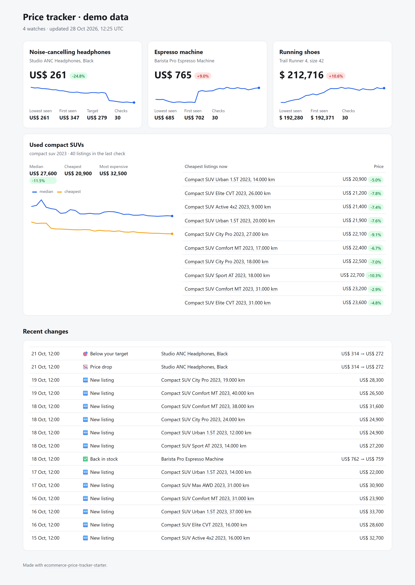

# E-commerce Price Tracker Starter

**Track prices across online stores and marketplaces, get an alert when they drop, and publish a price history dashboard. It runs free on GitHub Actions, with no server.**

[](https://github.com/PedroJDre/ecommerce-price-tracker-starter/actions/workflows/ci.yml)
[](https://github.com/PedroJDre/ecommerce-price-tracker-starter/actions/workflows/track.yml)


You list what to watch in one file: single products (a pair of shoes, a coffee machine) or whole searches (every used SUV of a model, a store's whole catalog). Every day it checks prices, keeps the history, tells you what changed, and updates a dashboard.

**[See the live dashboard →](https://pedrojdre.github.io/ecommerce-price-tracker-starter/)** It tracks the example watchlist in this repo and updates once a day.


<sub>The screenshot uses sample data from `scripts/demo.py`.</sub>

## What it does

- 🛍️ **Works with most stores without writing selectors.** It reads the structured price data that stores publish for Google Shopping (JSON-LD, Open Graph, microdata). That covers most Shopify, WooCommerce, VTEX, Tiendanube and Magento stores.
- ⚡ **Shopify, natively.** Any Shopify store's product or whole catalog is read from its own JSON, with no HTML parsing.
- 🇦🇷 **Mercado Libre** through the official API (it needs a free token), for searches like "every BAIC on sale in Argentina".
- 🔎 **Search tracking.** It tracks the median and cheapest price of a search over time and flags new listings. Filters drop accessories and parts (`include`, `exclude`, `min_price`, `max_price`).
- 🔔 **Alerts** to Telegram, Slack, Discord or email for price drops, prices under your target, items back in stock, and new listings. Each alert is sent once, when the price crosses the line, not on every run.
- 📊 **Static dashboard** with price charts and recent changes, in a single HTML file with no JavaScript. Light and dark mode, works on phones.
- 🤖 **Optional LLM fallback (LangChain)** for pages with no structured data. The model reads the page, and its answer is only accepted if the exact price text appears on the page, so it can't invent one.
- 🧱 **Hard to break.** A store that fails or blocks you doesn't stop the other watches; the dashboard shows the error. An empty search is reported as an error instead of "everything sold out". Requests to the same store are spaced out.
- ✅ **50 tests**, all offline with mocked HTTP.

## Quick start

You need Python 3.12+ and [uv](https://docs.astral.sh/uv/).

```bash
git clone https://github.com/PedroJDre/ecommerce-price-tracker-starter.git
cd ecommerce-price-tracker-starter
uv sync
cp watchlist.example.toml watchlist.toml

uv run tracker check https://www.allbirds.com/products/mens-tree-runners   # test any URL
uv run tracker run                                                          # check everything
```

Open `docs/index.html` to see the dashboard. Changes show up from the second run on. To see a full dashboard right away, run `uv run python scripts/demo.py`, which builds `demo/index.html` from 30 days of sample data.

## Run it every day on GitHub (free)

1. Fork this repo and edit `watchlist.toml`.
2. **Settings → Pages:** deploy from the `main` branch, `/docs` folder.
3. **Actions:** enable workflows, open *Track prices* and click *Run workflow* once.
4. Add the secrets for the alerts you want in **Settings → Secrets and variables → Actions**.

The workflow runs daily at 11:00 UTC (change the `cron` line in `.github/workflows/track.yml`). It commits the price history (`data/prices.db`, SQLite) and the dashboard back to the repo. GitHub pauses scheduled workflows in repos with no activity for 60 days. The daily commits count as activity, but if it ever pauses, re-enable it from the Actions tab.

## The watchlist

```toml
[[product]]
name = "Allbirds Tree Runner"
url = "https://www.allbirds.com/products/mens-tree-runners"
target_price = 80            # alert when it drops to this or below

[[search]]
name = "Allbirds men's runners"
source = "shopify"
url = "https://www.allbirds.com/collections/mens"
include = ["runner"]         # every word must be in the title
exclude = ["sock", "insole"] # none of these

[[search]]
name = "BAIC cars on Mercado Libre"
source = "mercadolibre"
site = "MLA"                 # MLA Argentina, MLB Brazil, MLM Mexico...
query = "baic"
min_price = 5000             # skip parts and accessories
```

| Source | For | Products | Searches |
| --- | --- | :---: | :---: |
| `page` (default) | Any store that publishes structured price data | ✅ | — |
| `shopify` | Shopify stores (reads their JSON) | ✅ | ✅ store or collection |
| `mercadolibre` | Mercado Libre, all countries (needs `MELI_ACCESS_TOKEN`) | ✅ | ✅ |

`[settings]` options: `title`, `drop_threshold_percent` (default 5, smaller moves are ignored), `delay_seconds`, `llm_fallback`, `llm_model`, `database`, `report`. The [example watchlist](watchlist.example.toml) explains each one.

## Alerts

Turn channels on in `[alerts]` and set their secrets as environment variables (or GitHub secrets):

| Channel | Setting | Secrets |
| --- | --- | --- |
| Telegram | `telegram = true` | `TELEGRAM_BOT_TOKEN`, `TELEGRAM_CHAT_ID` |
| Slack or Discord | `webhook = true` | `ALERT_WEBHOOK_URL` |
| Email | `email = true` | `SMTP_HOST`, `SMTP_PORT`, `SMTP_USER`, `SMTP_PASSWORD`, `ALERT_EMAIL_TO` |

Pick which changes trigger an alert with `events = [...]`. The options are `price_drop`, `price_up`, `below_target`, `back_in_stock`, `out_of_stock` and `new_listing`.

## Mercado Libre token

Mercado Libre's search API now needs a token (it answers 403 without one). Scraping the site gets blocked fast and needs paid proxies, so this starter uses the API.

1. Create an app at [developers.mercadolibre.com](https://developers.mercadolibre.com/).
2. Follow their OAuth guide to get an access token.
3. Set it as `MELI_ACCESS_TOKEN`. Access tokens expire after a few hours. For daily runs, store a refresh token and add a step that renews it, or run from a machine that keeps it fresh.

## LLM fallback for pages without structured data

```bash
uv sync --extra llm
export ANTHROPIC_API_KEY=...
```

```toml
[settings]
llm_fallback = true
llm_model = "anthropic:claude-haiku-5-5"   # any LangChain "provider:model"
```

The fallback only runs when a page has no structured data. The model returns the price exactly as written on the page, and the tracker checks that this text is on the page before accepting it. A made-up number gets dropped.

## Project structure

```
src/price_tracker/
  sources/page.py          # JSON-LD, Open Graph and microdata extraction
  sources/shopify.py       # Shopify product and catalog JSON
  sources/mercadolibre.py  # Mercado Libre API
  sources/llm.py           # optional LangChain fallback, with a check against the page
  prices.py                # "$ 1.234,56", "US$ 1,299", "£51.77" → numbers
  tracker.py               # one run: fetch, filter, compare, store
  detect.py                # what changed: drops, targets, stock, new listings
  alerts.py                # Telegram, webhooks, email
  report.py                # static HTML dashboard
  db.py                    # SQLite history
  cli.py                   # tracker run | report | check
scripts/demo.py            # dashboard with 30 days of sample data
```

## Use it responsibly

Check each site's terms before tracking it, keep the default delay between requests, and don't run it more often than you need. Once or twice a day is plenty for prices.

## About

Built by [Pedro Dreyer](https://www.linkedin.com/in/pedro-dreyer/) at [Loopers](https://loopersarg.com). It grew out of a Mercado Libre price monitor we built for a car dealership. Need something like this for your business? [Get in touch](https://loopersarg.com).

MIT licensed.
